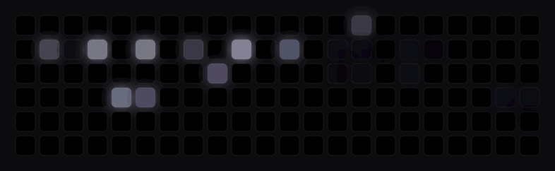
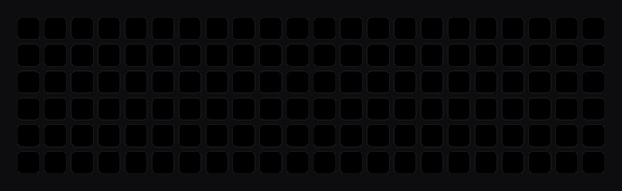

# memrazer-cynosa

[](https://github.com/MehmetEmreee/memrazer-cynosa/actions/workflows/ci.yml)
[](LICENSE)


**English** · [Türkçe](#türkçe)

macOS driver and app for the **Razer Cynosa V2**. No kernel extension, no permission prompts.

| Sky / Gökyüzü | Fire / Şömine |
| --- | --- |
|  |  |

## Features

- On-device effects: static, breathing, spectrum, wave, reactive, starlight, off
- Live effects: **Sky** (real sun and moon position, phases, clouds, airliners), fire, rainbow
- Animated GIF / APNG / WebP playback
- Brightness and game mode
- Runs in the background from the menu bar and starts at login: left-click for quick controls, right-click for the menu
- Live keyboard preview; settings are restored on launch and reconnect
- Command-line tool

## Download

Get the latest `memrazer-cynosa-<version>.dmg` from [Releases](https://github.com/MehmetEmreee/memrazer-cynosa/releases/latest), open it and drag the app to Applications.

## Build from source

Requires macOS 14+ and Xcode 15+.

```bash
git clone https://github.com/MehmetEmreee/memrazer-cynosa.git
cd memrazer-cynosa
./scripts/build-app.sh
cp -R build/memrazer-cynosa.app /Applications/
```

## CLI

```bash
build/cynosa info
build/cynosa static ff8800
build/cynosa sky 0.6 --fast
build/cynosa gif fireplace.gif
build/cynosa brightness 70
```

Run `build/cynosa --help` for every command.

## Development

```bash
swift build
swift test
```

| Path | Contents |
| --- | --- |
| `Sources/CUSB` | USB control transfers (IOKit) |
| `Sources/CynosaKit` | Protocol, transport, hot-plug, effects, frame player |
| `Sources/CynosaApp` | SwiftUI app |
| `Sources/cynosa` | CLI |
| `Sources/render-previews` | Renders the README GIFs |

Live effects send only the key rows that changed and adapt their frame rate (15 fps idle, 60 fps while something moves fast).

## Credits

Protocol details from [OpenRazer](https://github.com/openrazer/openrazer) and [razer-macos](https://github.com/1kc/razer-macos). Not affiliated with Razer Inc.

## License

[GPL-2.0-or-later](LICENSE)

---

## Türkçe

**Razer Cynosa V2** için macOS sürücüsü ve uygulaması. Çekirdek uzantısı yok, izin istemez.

### Özellikler

- Klavyede çalışan efektler: sabit, nefes, spektrum, dalga, tepki, yıldız, kapalı
- Canlı efektler: **Gökyüzü** (gerçek güneş ve ay konumu, ay evreleri, bulutlar, yolcu uçakları), şömine, gökkuşağı
- Hareketli GIF / APNG / WebP oynatma
- Parlaklık ve oyun modu
- Menü çubuğunda arka planda çalışır, bilgisayar açılınca kendiliğinden başlar: sol tık hızlı kontroller, sağ tık menü
- Canlı klavye önizlemesi; ayarlar açılışta ve yeniden bağlanınca geri yüklenir
- Komut satırı aracı

### İndir

En son `memrazer-cynosa-<sürüm>.dmg` dosyasını [Releases](https://github.com/MehmetEmreee/memrazer-cynosa/releases/latest) sayfasından indir, aç ve uygulamayı Applications klasörüne sürükle.

### Kaynaktan derleme

macOS 14+ ve Xcode 15+ gerekir.

```bash
git clone https://github.com/MehmetEmreee/memrazer-cynosa.git
cd memrazer-cynosa
./scripts/build-app.sh
cp -R build/memrazer-cynosa.app /Applications/
```

### Komut satırı

```bash
build/cynosa info
build/cynosa static ff8800
build/cynosa sky 0.6 --fast
build/cynosa gif somine.gif
build/cynosa brightness 70
```

Tüm komutlar için `build/cynosa --help`.

### Geliştirme

```bash
swift build
swift test
```

Canlı efektler yalnızca değişen tuş satırlarını gönderir ve kare hızını duruma göre ayarlar (sakinken 15 fps, hızlı hareket varken 60 fps).

### Teşekkür

Protokol bilgileri [OpenRazer](https://github.com/openrazer/openrazer) ve [razer-macos](https://github.com/1kc/razer-macos) projelerinden alındı. Razer Inc. ile bağlantısı yoktur.

### Lisans

[GPL-2.0-or-later](LICENSE)
